# Image-Handling-and-Pixel-Transformations-Using-OpenCV 

## AIM:
Write a Python program using OpenCV that performs the following tasks:

1) Read and Display an Image.  
2) Adjust the brightness of an image.  
3) Modify the image contrast.  
4) Generate a third image using bitwise operations.

## Software Required:
- Anaconda - Python 3.7
- Jupyter Notebook (for interactive development and execution)

## Algorithm:
### Step 1:
Load an image from your local directory and display it.

### Step 2:
Create a matrix of ones (with data type float64) to adjust brightness.

### Step 3:
Create brighter and darker images by adding and subtracting the matrix from the original image.  
Display the original, brighter, and darker images.

### Step 4:
Modify the image contrast by creating two higher contrast images using scaling factors of 1.1 and 1.2 (without overflow fix).  
Display the original, lower contrast, and higher contrast images.

### Step 5:
Split the image (boy.jpg) into B, G, R components and display the channels

## Program Developed By:
 ## Name:SHRAVANI M
 ## Register Number:212224230263

  ## Ex. No. 01
```python
import cv2
import matplotlib.pyplot as plt
```
```python
# Read the image using OpenCV
img = cv2.imread('photo.jpeg', cv2.IMREAD_COLOR)
```
```python
# Convert BGR (OpenCV's default) to RGB (Matplotlib's expected color order)
img_rgb = cv2.cvtColor(img, cv2.COLOR_BGR2RGB)
```

```python
# Display the image using matplotlib imshow().
plt.imshow(img_rgb, cmap='viridis')  # You can change 'viridis' to another cmap or use None for RGB images
plt.title("Original Image")
plt.axis('off')  # Removes axis ticks and labels
plt.show()
```
## OUTPUT :


```python
# Load the image
image = cv2.imread('photo.jpeg') 
```
```python
# Convert BGR (OpenCV's default) to RGB (Matplotlib's expected color order)
img_rgb = cv2.cvtColor(img, cv2.COLOR_BGR2RGB)
img_rgb.shape
```


```python
# Draw a line from top-left to bottom-right
line_img = cv2.line(img_rgb, (0, 0), (768, 600), (255, 0, 0), 2) # cv2.line(image, start_point, end_point, color, thickness)
```
```python
plt.imshow(line_img, cmap='viridis')  
plt.title("Image with Line")
plt.axis('off')  
plt.show()
```

## OUTPUT :


```python
# Load the image
image = cv2.imread('photo.jpeg')

# Convert BGR (OpenCV's default) to RGB (Matplotlib's expected color order)
img_rgb = cv2.cvtColor(img, cv2.COLOR_BGR2RGB)
img_rgb.shape

```
## OUTPUT :


```python
circle_img = cv2.circle(img_rgb,(400,300),150,(255,0,0),10) # cv2.circle(image, center, radius, color, thickness)
```

```python
plt.imshow(circle_img, cmap='viridis')  
plt.title("Image with Circle")
plt.axis('off')  
plt.show()
```

## OUTPUT :

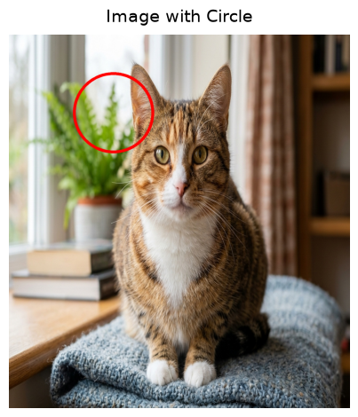


```python
# Load the image
image = cv2.imread('photo.jpeg') 

# Convert BGR (OpenCV's default) to RGB (Matplotlib's expected color order)
img_rgb = cv2.cvtColor(img, cv2.COLOR_BGR2RGB)
img.shape
```

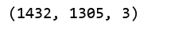

```python
# Draw a rectangle around the Whole image
rectangle_img = cv2.rectangle(img_rgb, (0, 0), (768, 600), (0, 0, 255), 10)  # cv2.rectangle(image, start_point, end_point, color, thickness)
```
```python
plt.imshow(rectangle_img, cmap='viridis')  
plt.title("Image with Rectangle")
plt.axis('off')  
plt.show()
```

## OUTPUT :

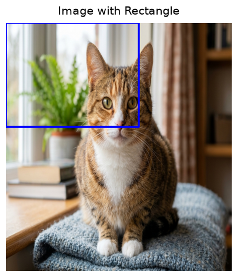


```python
# Load the image
image = cv2.imread('photo.jpeg') 

# Convert BGR (OpenCV's default) to RGB (Matplotlib's expected color order)
img_rgb = cv2.cvtColor(img, cv2.COLOR_BGR2RGB)
```
```python
# Add text to the image
text_img = cv2.putText(img_rgb, "OpenCV Drawing", (10, 30), cv2.FONT_HERSHEY_SIMPLEX, 1, (255, 255, 255), 10)  ## cv2.putText(image, text, position, font, font_scale, color, thickness)
```
```python
plt.imshow(text_img, cmap='viridis')  
plt.title("Image with Text")
plt.axis('off')  
plt.show()
```

## OUTPUT :


```python
# Load the image
image = cv2.imread('photo.jpeg')
image_rgb = cv2.cvtColor(image, cv2.COLOR_BGR2RGB)
```
```python
# Original RGB Image
plt.imshow(image_rgb)
plt.title("Original RGB Image")
plt.axis("off")
```
## OUTPUT : 


```python
# Convert RGB to HSV
image_hsv = cv2.cvtColor(image_rgb, cv2.COLOR_RGB2HSV)

# HSV Image
plt.imshow(image_hsv)
plt.title("HSV Image")
plt.axis("off")
```

# OUTPUT :

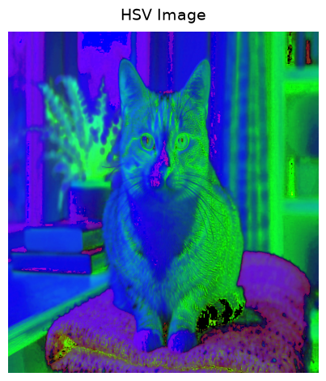


```python
# Convert RGB to GRAY
image_gray = cv2.cvtColor(image_rgb, cv2.COLOR_RGB2GRAY)
```
```python
# Grayscale Image
plt.imshow(image_gray, cmap='gray')
plt.title("Grayscale Image")
plt.axis("off")
```

## OUTPUT :

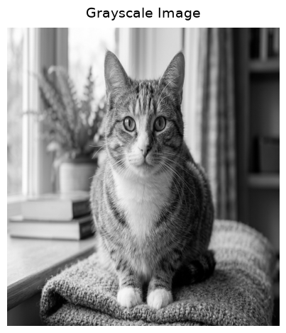


```python
# Convert RGB to YCrCb
image_ycrcb = cv2.cvtColor(image_rgb, cv2.COLOR_RGB2YCrCb)
```
```python
# YCrCb Image
plt.imshow(image_ycrcb)
plt.title("YCrCb Image")
plt.axis("off")
```

## OUTPUT :

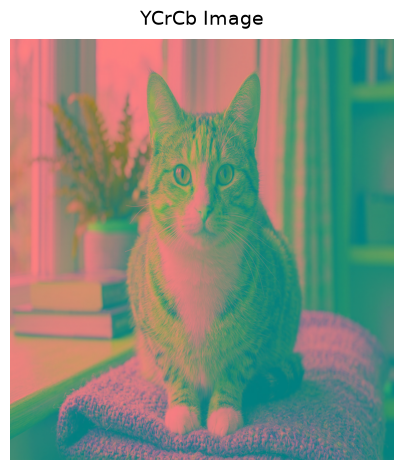


```python
# Convert HSV back to RGB
image_hsv_to_rgb = cv2.cvtColor(image_hsv, cv2.COLOR_HSV2RGB)
plt.imshow(image_hsv_to_rgb)
plt.title("HSV to RGB Image")
plt.axis("off")
```

## OUTPUT :


```python
# Modify a block of pixels (300x300) to white, starting from (200, 200)
image[200:500, 200:500] = [255, 255, 255]  # Rows: 200-499, Columns: 200-499

# Convert BGR to RGB for displaying with Matplotlib
image_rgb = cv2.cvtColor(image, cv2.COLOR_BGR2RGB)
```
```python
# Display the modified image
plt.imshow(image_rgb)
plt.title("Image with 300x300 White Block")
plt.axis("off")
plt.show()
```

## OUTPUT :

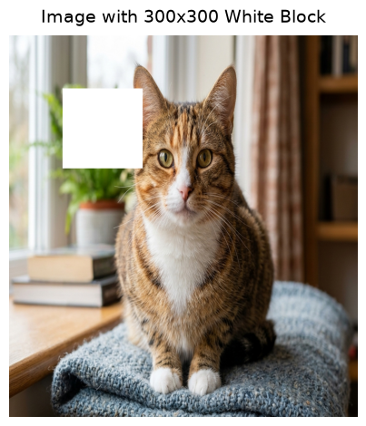


```python
# Load the image
image = cv2.imread('photo.jpeg')
image.shape
```
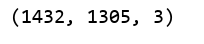

```python
# Resize the image to half its size
resized_image = cv2.resize(image, (768 // 2, 600 // 2))  # (new_width, new_height)

# Convert BGR to RGB for displaying with Matplotlib
resized_image_rgb = cv2.cvtColor(resized_image, cv2.COLOR_BGR2RGB)
resized_image_rgb.shape
```

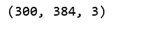

```python
# Display the resized image
plt.imshow(resized_image_rgb)
plt.title("Resized Image (Half Size)")
plt.axis("off")
plt.show()
```

## OUTPUT :

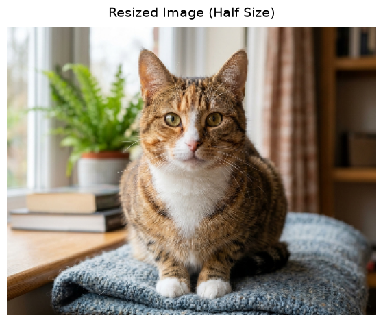


```python
# Load the image
image = cv2.imread('photo.jpeg')
image.shape
```


```python
# Crop a 300x300 region starting from (50, 50)
roi = image[50:350, 50:350]  # Rows: 50-349, Columns: 50-349

# Convert BGR to RGB for displaying with Matplotlib
roi_rgb = cv2.cvtColor(roi, cv2.COLOR_BGR2RGB)
```
```python
# Display the cropped region (ROI)
plt.imshow(roi_rgb)
plt.title("Cropped Region of Interest (ROI)")
plt.axis("off")
plt.show()
```
## OUTPUT :

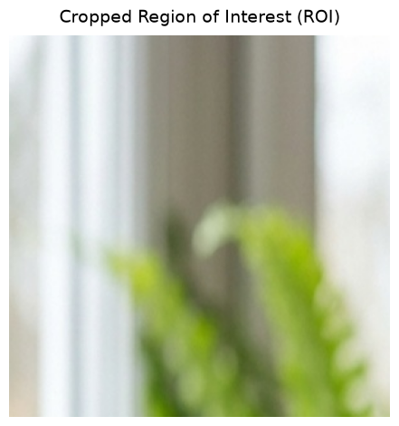


```python
# Load the image
image = cv2.imread('photo.jpeg')

# Flip the image horizontally (left-right)
flipped_horizontally = cv2.flip(image, 1)

# Convert BGR to RGB for displaying with Matplotlib
flipped_horizontally_rgb = cv2.cvtColor(flipped_horizontally, cv2.COLOR_BGR2RGB)
```
```python
# Horizontal flip
plt.imshow(flipped_horizontally_rgb)
plt.title("Flipped Horizontally")
plt.axis("off")
```
## OUTPUT :

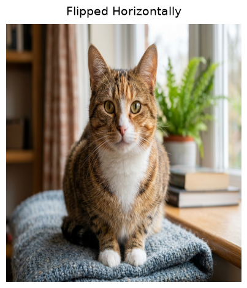


```python
# Flip the image vertically (up-down)
flipped_vertically = cv2.flip(image, 0)

# Convert BGR to RGB for displaying with Matplotlib
flipped_vertically_rgb = cv2.cvtColor(flipped_vertically, cv2.COLOR_BGR2RGB)
```
```python
# Vertical flip
plt.imshow(flipped_vertically_rgb)
plt.title("Flipped Vertically")
plt.axis("off")
```
## OUTPUT :

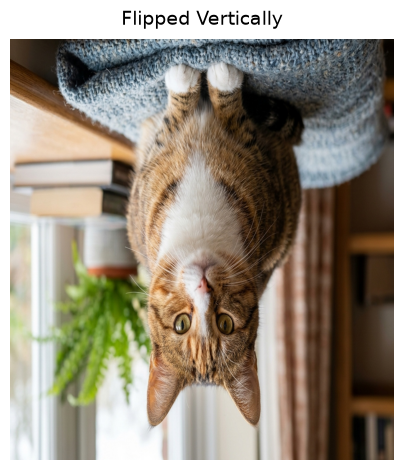


## Result:
Thus, the images were read, displayed, brightness and contrast adjustments were made, and bitwise operations were performed successfully using the Python program.